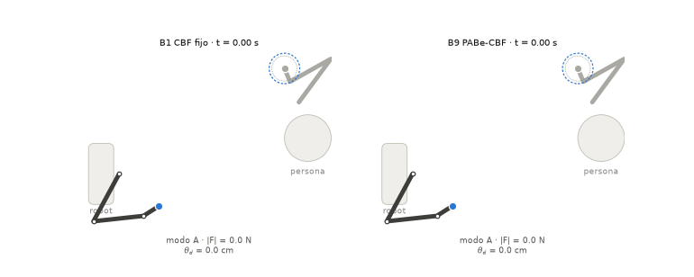

# PABe-CBF

**Barreras de seguridad gobernadas por viabilidad, fase de interacción y entropía de creencias para el apretón de manos humano–humanoide (Unitree G1).**

> **English summary.** PABe-CBF is a safety filter for physical human–humanoid interaction. An HMM estimates whether the person is engaged, hesitant or withdrawing; a calibrated withdrawal risk decides when to release, while excess entropy only asks for caution; and the safety margins are optimisation variables of the same QP as the robot command (a *viability governor*). This repository contains the full implementation, nine baselines and ablations, a planar benchmark and a MuJoCo benchmark on the Unitree G1, with all figures, tables and comparison videos. Results are from simulation only.



## Qué contiene

| Ruta | Contenido |
| --- | --- |
| `pabe_cbf/core.py` | Núcleo compartido por todos los métodos: reglas de riesgo, QP conjunto (gobernador), variantes |
| `pabe_cbf/belief.py` | HMM y HSMM por modo, entropía, $H_{\rm ref}$, calibración isotónica de $p_W^+$ |
| `pabe_cbf/sim.py`, `scenarios.py` | Banco planar (brazo de 3 GDL) y escenarios humanos |
| `pabe_cbf/g1/` | Banco Unitree G1 en MuJoCo: episodio, geometría 3D, entrenamiento, experimentos, informe, videos |
| `scripts/` | Descarga del modelo y ejecución reproducible de cada banco |
| `docs/propuesta/` | Manuscrito de la propuesta (LaTeX) |
| `docs/evaluacion_planar/`, `docs/evaluacion_g1/` | Secciones de resultados (PDF + LaTeX + figuras + tablas) |
| `media/` | Videos de comparación (inglés) |

Métodos comparados: **B0** nominal sin filtro · **B1** CBF fijo · **B2** HMM-MAP · **B3** HMM-entropía · **B4** BCBF · **B5** CRC-CBF · **B6** TV-CBF · **B7** SHIELD · **B8** RCIP · **B9 PABe-CBF** · ablaciones **A1–A11**. B4–B8 son adaptaciones al saludo con contacto, no reproducciones de sus artículos.

## Instalación

```bash
python -m venv .venv && source .venv/bin/activate
pip install -e .            # banco planar
pip install -e ".[g1]"      # + MuJoCo para el banco G1
bash scripts/fetch_g1_model.sh   # descarga el modelo Unitree G1 (MuJoCo Menagerie)
```

Para el renderizado sin pantalla del banco G1 usa `export MUJOCO_GL=egl`. Los videos requieren `ffmpeg`.

## Uso rápido

```python
from pabe_cbf.scenarios import Participant, Scenario
from pabe_cbf.g1.geometry import G1_GEOM
from pabe_cbf.g1.episode import G1Episode
from pabe_cbf.core import METHODS

sc = Scenario("iii_withdraw_contact", Participant(5, geom=G1_GEOM), 0)
res, _, _ = G1Episode(METHODS["B1"], sc, None).run()   # B1 no necesita modelos entrenados
print(res["R_reason"], res["peak_F"], res["V_any"])
```

## Reproducir los resultados

```bash
bash scripts/run_planar.sh        # banco planar (~30 min)
bash scripts/run_g1_pipeline.sh   # banco G1: entrena, valida, evalúa, informe y videos (~90 min, 10 procesos)
```

Los resultados se escriben en `results/` (no versionado). La ejecución del G1 es tolerante a fallos: si se interrumpe, al relanzarla retoma donde quedó. Las particiones son disjuntas por participante simulado: entrenamiento, calibración, validación (umbrales) y test.

## Resultados principales (G1 simulado, 360 episodios de test por método)

| Qué se midió | PABe-CBF | Comparador |
| --- | --- | --- |
| Violaciones físicas | 0 % | CBF fijo 3,6 %; SHIELD 18 %; sin filtro 26 % |
| Liberaciones fallidas cuando la persona se retira | 0 % | CBF fijo 37 %; SHIELD 62 % |
| Cancelaciones falsas: solo riesgo vs. riesgo + entropía (igual sensibilidad) | 29,8 % | 37,6 % |
| Episodios con QP infactible: gobernador vs. margen instantáneo | 45 % | 77 % |
| Saludos completados | 64 % | CBF fijo 70 % |

- **Seguridad:** es la mejora clara.
- **H1 y H2 se apoyan:** separar el riesgo de la entropía en la regla de liberación y el gobernador de viabilidad muestran ventajas significativas cuando cada uno se aísla.
- **Frente a la mejor ley de margen exógena ajustada,** el gobernador solo aporta suavidad.
- **No se apoyan:** las barreras por eslabón y el uso de la entropía excedente en los márgenes no mostraron beneficio.

Detalle, estadística (bootstrap por participante con corrección de Holm) y amenazas a la validez en [`docs/evaluacion_g1/main_g1.pdf`](docs/evaluacion_g1/main_g1.pdf).

## Videos

| Video | Comparación |
| --- | --- |
| [`1_hesitation_B9_vs_B3.mp4`](media/1_hesitation_B9_vs_B3.mp4) | Duda inocua: B3 libera en falso, PABe-CBF completa el saludo |
| [`2_viability_B9_vs_A1.mp4`](media/2_viability_B9_vs_A1.mp4) | Margen suave del gobernador frente a margen que salta |
| [`3_withdrawal_B9_vs_SHIELD.mp4`](media/3_withdrawal_B9_vs_SHIELD.mp4) | Retirada rápida: SHIELD supera 20 N, PABe-CBF suelta a tiempo |
| [`PABe-CBF_vs_baselines_all.mp4`](media/PABe-CBF_vs_baselines_all.mp4) | Los tres juntos con resumen |

Cada episodio se eligió con un criterio explícito (`media/video_episodes.txt`) y cada video muestra la estadística agregada del test.

## Extensiones (octubre 2026)

Cambios sobre la versión original; los resultados ya no coinciden con los publicados en `docs/`.

| Cambio | Dónde |
| --- | --- |
| Barrera de autocolisión brazo–torso, siempre activa (el brazo atravesaba el pecho) | `pabe_cbf/g1/episode.py` |
| Giro de la palma hacia la palma de la persona (saludo con pulgar arriba) | `pabe_cbf/g1/episode.py` |
| `PABE_ROBOT=revo2`: G1 con manos BrainCo Revo2 (51 GDL) desde un URDF (`PABE_REVO2_URDF`, no incluido) | `pabe_cbf/g1/model.py` |
| Familia `x_walk_hesitation`: ambos caminan uno hacia el otro, con 6 variantes de duda al azar | `pabe_cbf/scenarios.py` |
| `iv_hesitation` amplificada en 3D (retroceso de 15 cm a mitad del alcance) | `pabe_cbf/scenarios.py` |
| Sistema de aproximación con creencia propia (políticas P0–P3) y traspaso al sistema de saludo | `pabe_cbf/approach.py` |
| Etapas `approach` y `walk` | `pabe_cbf/g1/experiments.py` |

```bash
python -m pabe_cbf.g1.experiments approach                 # banco A: solo la aproximación
python -m pabe_cbf.g1.experiments walk --approach P3       # aproximación y luego saludo
python view_walk_handshake.py --pid 4006 --models results/g1/models.pkl --approach P3   # visor
python view_episode.py --family iv_hesitation              # repetición de un episodio
```

El port a Isaac Sim está en un proyecto aparte (PABe-Isaac).

## Limitaciones

- **Solo simulación:** en el G1 la base es fija, el humano es cinemático y el contacto es un resorte.
- **Observaciones sintéticas:** las del HMM son sintéticas, y las cotas de error y los límites de fuerza son de simulación, no validados en hardware.
- **Paso al robot real:** requiere percepción humana real, datos etiquetados de personas, identificar las cotas en el robot y aprobación ética.

## Licencia

MIT, ver [`LICENSE`](LICENSE). El modelo del G1 (BSD-3, Unitree Robotics) y las dependencias se obtienen por separado; ver [`THIRD_PARTY.md`](THIRD_PARTY.md).
